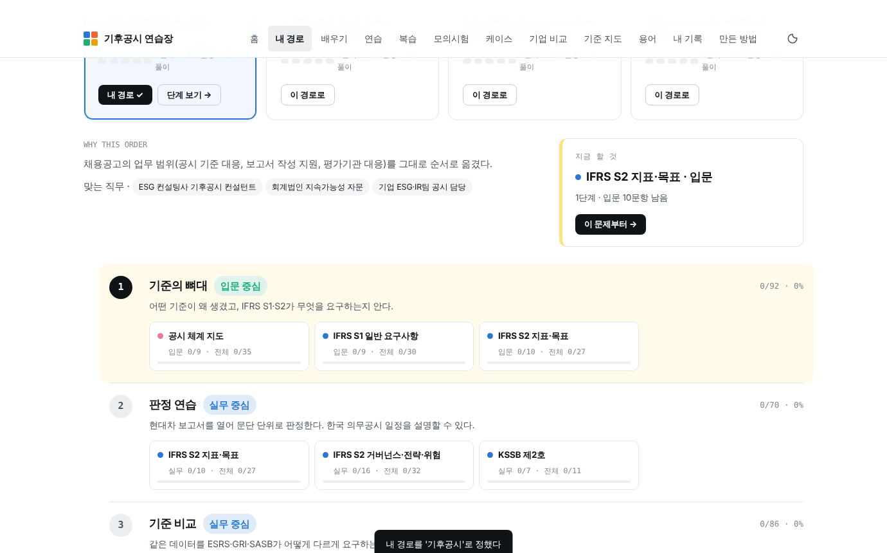
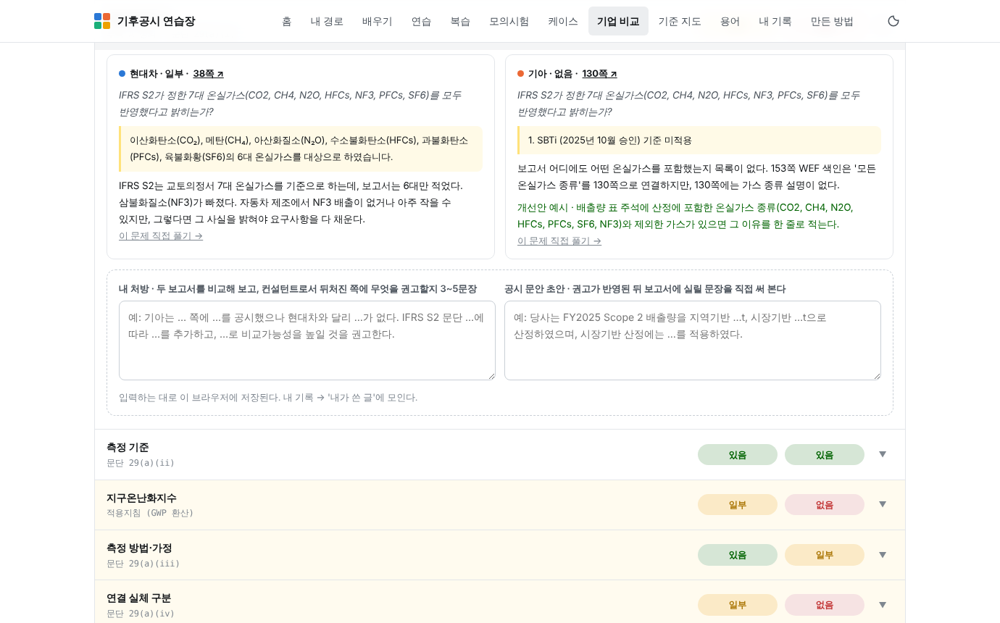
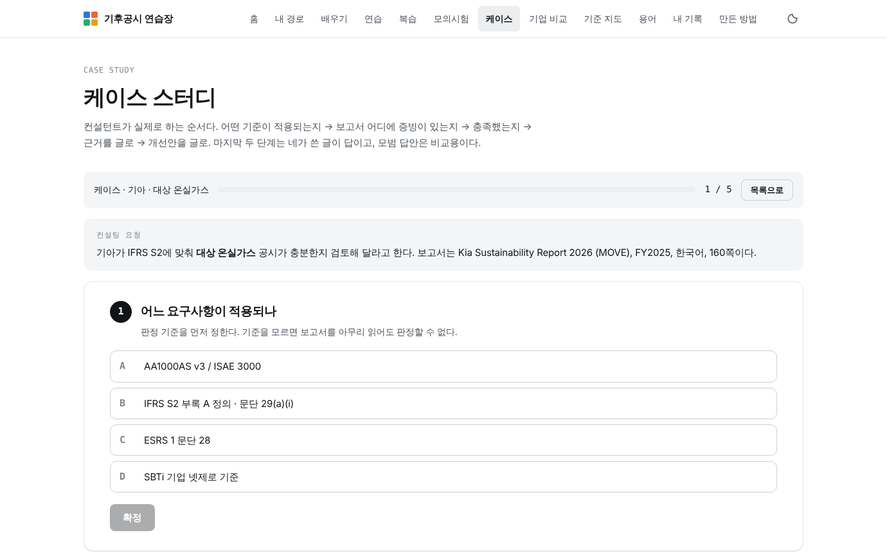

# Climate Change Professional Maker · 기후공시 연습장 (v3)

기후공시 컨설턴트가 되기 위해 **어떤 기후공시 문제가 나와도 풀 수 있게** 만든 학습 웹앱입니다.
지원하는 직무에 맞는 경로를 고르고, 실제 보고서 두 권(현대자동차·기아, FY2025)을 열어 판정하고, 숫자를 계산하고, 근거와 개선안을 직접 씁니다.

**라이브:** `index.html` 하나로 동작합니다. GitHub Pages를 켜면 바로 열립니다. 기록은 브라우저(localStorage)에만 저장되며, 내 기록 화면에서 JSON으로 내보내고 가져올 수 있습니다.


## v3에서 달라진 것

| 기능 | 내용 |
|---|---|
| **내 경로** (취업 경로별 학습) | 기후공시 / 규제대응 / LCA / 통합 흐름 4경로. 경로를 고르면 5단계 스테퍼, 모듈 순서, 난이도, '지금 할 것' 추천이 바뀝니다. 추천은 정답률·남은 문항·약한 모듈로 매번 다시 계산합니다. |
| **기업 비교** | 현대차에 던진 71개 판정 질문을 기아 보고서에도 그대로 던졌습니다. 같은 질문 64개, 판정이 다른 29개. 줄을 펼치면 두 보고서 원문·해설이 나란히 나오고, **내 처방**과 **공시 문안 초안**을 직접 씁니다. |
| **케이스 스터디** | 기준 식별 → 증빙 쪽 찾기 → 판정 → 근거 쓰기 → 개선안 쓰기의 5단계. 앞 3단계는 자동 채점, 뒤 2단계는 쓴 뒤에 모범 답안이 열리고 스스로 점검합니다 (8점 만점). |
| **문항 신뢰도 꼬리표** | 문항마다 '원문 대조 / 재검산 / 공식 자료 / 공식 자료·주의 / 2차 자료 / 확인 필요'가 붙고, 만든 방법 페이지에 모듈별 집계표가 있습니다. 모듈마다 **기준 시점**(전제하는 기준서 버전)을 적었습니다. |
| **왜 틀렸나** | 틀린 뒤 이유(기준을 몰랐다 / 못 찾았다 / 판단 착오 / 계산 실수 / 잘못 읽음)를 고르면 내 기록에 쌓이고 처방이 나옵니다. |
| 기아 회사 팩 | 판정 70 · 계산 12 문항 (`data/companies/kia.json`). 모든 인용문은 원문 텍스트와 대조했고 계산은 Python으로 재검산했습니다. |

## 무엇이 들어 있나

| 영역 | 모듈 |
|---|---|
| 지도 | 공시 체계 지도 |
| 공시 기준 | IFRS S1 · IFRS S2 지표·목표 · IFRS S2 거버넌스·전략·위험 · KSSB 제2호 · ESRS E1 기초 · ESRS·CSRD 심화 · GRI·SASB 기초 · GRI 심화 |
| 측정·검증 | GHG 프로토콜 · LCA·제품 탄소발자국 · 제3자 검증 · 물리적 위험·기후과학 · 시나리오 분석·재무영향 |
| 제도·시장 | 국내 기후 제도 · 탄소시장·CBAM · 감축목표·전환계획 · 금융배출량·택소노미 |
| 실무·평가 | ESG 평가 대응 · 보고서 작성 실무 |
| 기업 사례 | 기아 보고서 판정 (현대차 질문과 같은 key로 정렬) |

- **21개 모듈 · 626문항** — 판정(보고서 원문 대조) · 개념(객관식) · 계산, 난이도 입문/실무/전문가
- 모듈마다 **입문 글**과 **핵심 용어** → 용어집
- **복습 큐**(1→3→7→14일), **모의시험**, **내 기록**(영역별 정답률, 모듈×난이도 숙련도, 판정 경향, 왜 틀렸나, 내가 쓴 글)
- **기준 지도** — 공시 주제 8개를 IFRS S2·KSSB·ESRS·GRI·SASB·CDP 조항에 대응

| 내 경로 | 기업 비교 | 케이스 스터디 |
|---|---|---|
|  |  |  |

## 만든 방법과 역할

이 프로젝트는 AI(Claude)와 함께 만들었습니다. 역할을 분명히 적습니다.

**김수현이 한 일**
- 채용공고(ESG 컨설턴트)의 업무 범위에 맞춘 기준 선정, 전 영역 확장과 취업 경로별 학습 설계 기획
- "판정이 의견일 뿐 아니냐", "규칙형·원칙형은 없는 말이다", "내가 안 하면 끝나지 않는 구조다", "보고서를 역으로 읽는 건 정답지 베끼기 아니냐" 같은 문제 제기로 평가 방식과 설계를 바꿈 → 케이스 스터디와 처방 쓰기
- 문제 풀이, 판단 근거·개선안·처방 작성(내 기록), 기준서 검색용 RAG 구현(진행 중)

**AI가 한 일**
- 영역 설계, 기준서·법령·감독기관 공개 문서 대조, 문항과 입문 글, 회사 팩 작성
- 계산 문항 전부 Python 재검산, 두 보고서 인용문 쪽 대조
- 문제를 만들지 않은 별도 AI 세션(6갈래)의 교차 검토 후 수정 반영. **사람 전문가의 검토는 아직 받지 않았습니다.**
- 웹앱 설계와 구현

## 신뢰도와 한계

- 정답은 공개 자료를 대조한 해석입니다. 판정 문항의 '일부'와 '없음' 경계는 전문가마다 다를 수 있습니다.
- 문항 신뢰도 집계(빌드 시 자동): `data/check.json`. 앱 안 '만든 방법' 페이지에 모듈별 표가 있습니다. 2차 자료만으로 확인한 문항과 '주의' 표시 문항은 숨기지 않고 그대로 셉니다.
- 2025~2026년에 개정이 많습니다(IFRS S2 GHG 개정, ESRS 간소화, GHG 프로토콜 개정 진행, SBTi V2, 배출권거래제 4차 계획기간). 모듈의 '기준 시점'과 문항의 기준 연도를 함께 읽어야 합니다. 한국 의무공시 일정은 금융위 최종안 기준이며 법제화가 끝나야 확정됩니다.
- KCGS 공식 자료, KSSB 기준서 원문, 일부 ISO 문서는 열지 못해 2차 자료로 썼습니다.
- 틀린 문항을 찾으면 Issue로 알려 주세요. 출처 링크가 각 해설 끝에 있습니다.

## 구조

```
index.html              완성본(단일 파일, 자동 생성):  node src/build.js
src/page.html           페이지 템플릿 (HTML + JS)
src/style.css · extra.css · v3.css   스타일
src/build.js            데이터 합치기 + 데이터 검사(중복 id, 보기, 계산 허용오차, 출처 URL) + 신뢰도 꼬리표 부여
data/modules/*.json     15개 모듈 (lesson + items) · lessons-v1.json (v1 모듈 입문 글) · data/SCHEMA.md
data/v1/*.json          v1 모듈(KSSB·ESRS·GRI·SASB·ESG 평가·기준 지도) · ifrs-s2-data.js
data/companies/         kia.json (회사 팩) · keys.json (질문 key ↔ 현대차 문항) · BRIEF.md (회사 팩 규격)
data/tracks.json        취업 경로 4개 (단계·모듈·난이도·목표)
data/check.json         빌드 검사 결과 (문항 수, 신뢰도 집계, 경고)
reports/                기아 보고서 원문 PDF (판정 문항의 '원문 열기'가 쪽 단위로 연결)
archive/v1, v2          이전 완성본
```

문항 추가는 `data/modules/<module>.json`에 규격대로 넣고 `node src/build.js`를 실행하면 됩니다. 회사 팩 추가는 `data/companies/BRIEF.md` 규격으로 `<company>.json`을 만들고 build.js의 COMPANIES에 등록합니다.

## 다음 계획

- PostgreSQL(Supabase) DB화 → 검색(문항·용어·입문 글), 질문형 입구, 다중 사용자·사내 교육용 배포, 게시판(CRUD). 지금 데이터 규격이 그대로 테이블이 됩니다.

## 출처

현대자동차, 2026 지속가능성 보고서(FY2025) 국문판 · 기아, Sustainability Report 2026(FY2025) 국문판 · IFRS 재단(IFRS S1/S2, SASB) · 금융위원회·KSSB · EFRAG·EUR-Lex(ESRS, CSRD, CBAM) · GRI · GHG Protocol · SBTi · CDP · EcoVadis · S&P Global · 환경부·온실가스종합정보센터 · IPCC·IEA·NGFS · 기상청. 문항별 출처는 앱 안 해설과 '만든 방법' 페이지에 있습니다.

학습용 개인 프로젝트이며 현대자동차·기아 및 각 기준 제정기관과 무관합니다. 보고서 PDF는 원문 대조 학습 목적으로만 포함했습니다.
