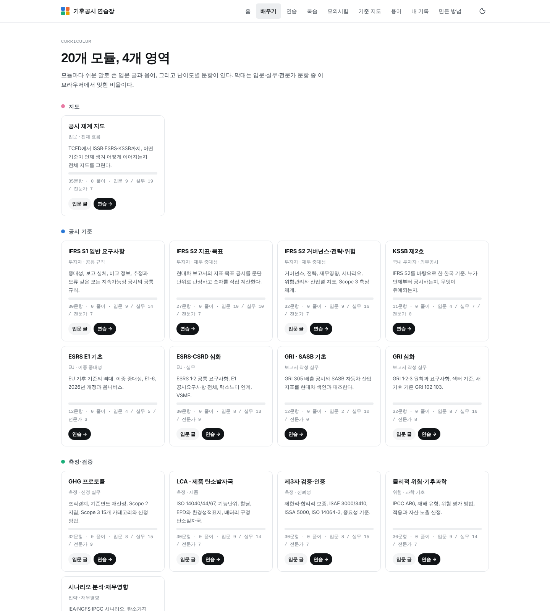
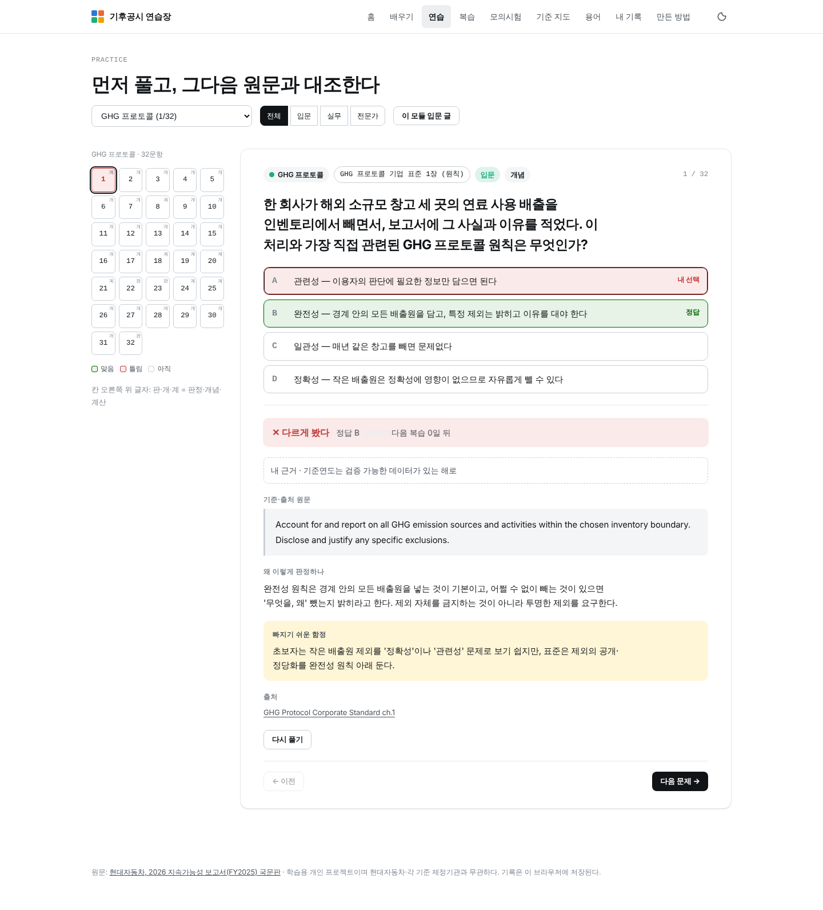
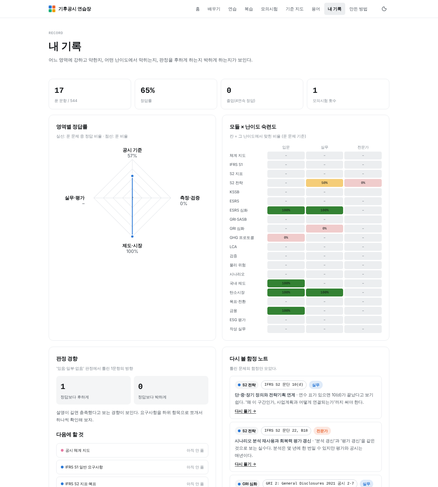

# Climate Change Professional Maker · 기후공시 연습장

기후공시 컨설턴트가 되기 위해 **어떤 기후공시 문제가 나와도 풀 수 있게** 만든 학습 웹앱입니다.
실제 보고서(현대자동차 2026 지속가능성 보고서, FY2025)를 열어 판정하고, 숫자를 계산하고, 기준끼리 비교하고, 틀린 문제를 다시 만납니다.

**라이브:** `index.html` 하나로 동작합니다. GitHub Pages를 켜면 바로 열립니다. 기록은 브라우저(localStorage)에만 저장됩니다.


## 무엇이 들어 있나

| 영역 | 모듈 |
|---|---|
| 지도 | 공시 체계 지도 (TCFD → ISSB·ESRS·KSSB, 국가별 도입 현황) |
| 공시 기준 | IFRS S1 · IFRS S2 지표·목표 · IFRS S2 거버넌스·전략·위험 · KSSB 제2호 · ESRS E1 기초 · ESRS·CSRD 심화 · GRI·SASB 기초 · GRI 심화 |
| 측정·검증 | GHG 프로토콜 · LCA·제품 탄소발자국 · 제3자 검증 · 물리적 위험·기후과학 · 시나리오 분석·재무영향 |
| 제도·시장 | 국내 기후 제도(탄소중립기본법·배출권거래제) · 탄소시장·CBAM · 감축목표·전환계획(SBTi) · 금융배출량·택소노미 |
| 실무·평가 | ESG 평가 대응(CDP·EcoVadis·S&P CSA·KCGS) · 보고서 작성 실무 |

- **20개 모듈 · 544문항** — 판정(보고서 원문 대조) · 개념(객관식) · 계산, 난이도 입문/실무/전문가
- 모듈마다 **입문 글**(쉬운 말 7~8절)과 **핵심 용어** 15개 → 용어집 225개
- **복습 큐**(1→3→7→14일 간격 반복, 4연속 정답 시 졸업), **모의시험**(영역·난이도·시간 설정), **내 기록**(영역별 정답률, 모듈×난이도 숙련도, 판정 경향, 약한 영역 추천)
- **기준 지도** — 공시 주제 8개를 IFRS S2·KSSB·ESRS·GRI·SASB·CDP 조항에 대응

| 배우기 | 연습 | 내 기록 |
|---|---|---|
|  |  |  |

## 만든 방법과 역할

이 프로젝트는 AI(Claude)와 함께 만들었습니다. 역할을 분명히 적습니다.

**김수현이 한 일**
- 채용공고(ESG 컨설턴트)의 업무 범위에 맞춘 기준 선정과 전 영역 확장 기획
- "판정이 의견일 뿐 아니냐", "규칙형·원칙형은 없는 말이다", "내가 안 하면 끝나지 않는 구조다" 같은 문제 제기로 평가 방식과 설계를 바꿈
- 문제 풀이와 판단 근거 기록(내 기록), 기준서 검색용 RAG 구현(진행 중)

**AI가 한 일**
- 영역 설계, 기준서·법령·감독기관 공개 문서 대조, 문항과 입문 글 작성
- 계산 문항 전부 Python 재검산, 현대차 보고서 인용문 쪽 대조
- 문제를 만들지 않은 별도 검토(6갈래)로 조항·날짜·숫자 재확인 후 수정 반영
- 웹앱 설계와 구현

## 신뢰도와 한계

- 정답은 공개 자료를 대조한 해석입니다. 판정 문항의 '일부'와 '없음' 경계는 전문가마다 다를 수 있습니다.
- 2025~2026년에 개정이 많습니다(IFRS S2 GHG 개정, ESRS 간소화, GHG 프로토콜 개정 진행, SBTi V2, 배출권거래제 4차 계획기간). 문항에 적힌 기준 연도를 함께 읽어야 합니다.
- KCGS 공식 자료, KSSB 기준서 원문, 일부 ISO 문서는 열지 못해 2차 자료로 썼고, 해당 문항은 해설에 '확인 필요' 또는 기준 시점을 적었습니다.
- 틀린 문항을 찾으면 Issue로 알려 주세요. 출처 링크가 각 해설 끝에 있습니다.

## 구조

```
index.html            완성본(단일 파일, 자동 생성)
src/page.html         페이지 템플릿 (HTML + JS)
src/style.css         기본 스타일 · src/extra.css  v2 추가 스타일
src/build.js          데이터를 합쳐 index.html 생성:  node src/build.js
data/modules/*.json   15개 모듈 (lesson + items)   · data/SCHEMA.md  데이터 규격
data/v1/*.json        v1 모듈(KSSB·ESRS·GRI·SASB·ESG 평가·기준 지도) · ifrs-s2-data.js
archive/v1/index.html v1 완성본
docs/screenshots/     구동 화면
```

문항 추가는 `data/modules/<module>.json`에 규격대로 넣고 `node src/build.js`를 실행하면 됩니다.

## 출처

현대자동차, 2026 지속가능성 보고서(FY2025) 국문판 · IFRS 재단(IFRS S1/S2, SASB) · 금융위원회·KSSB · EFRAG·EUR-Lex(ESRS, CSRD, CBAM) · GRI · GHG Protocol · SBTi · CDP · EcoVadis · S&P Global · 환경부·온실가스종합정보센터 · IPCC·IEA·NGFS · 기상청. 문항별 출처는 앱 안 해설과 '만든 방법' 페이지에 있습니다.

학습용 개인 프로젝트이며 현대자동차 및 각 기준 제정기관과 무관합니다.
