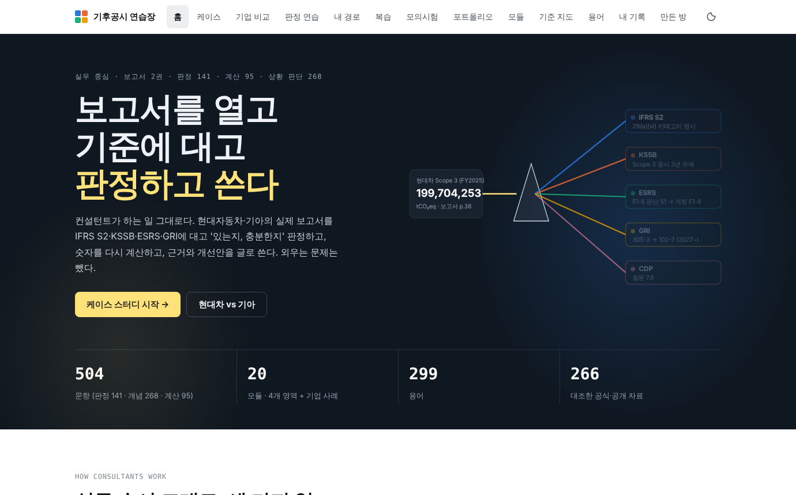
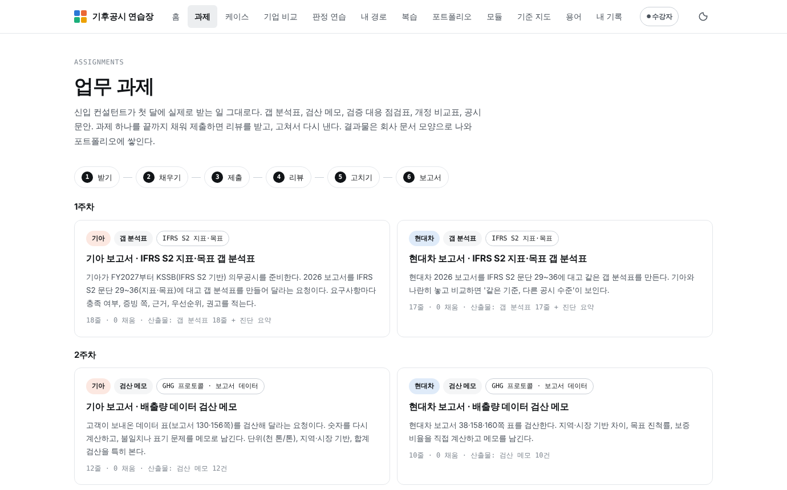
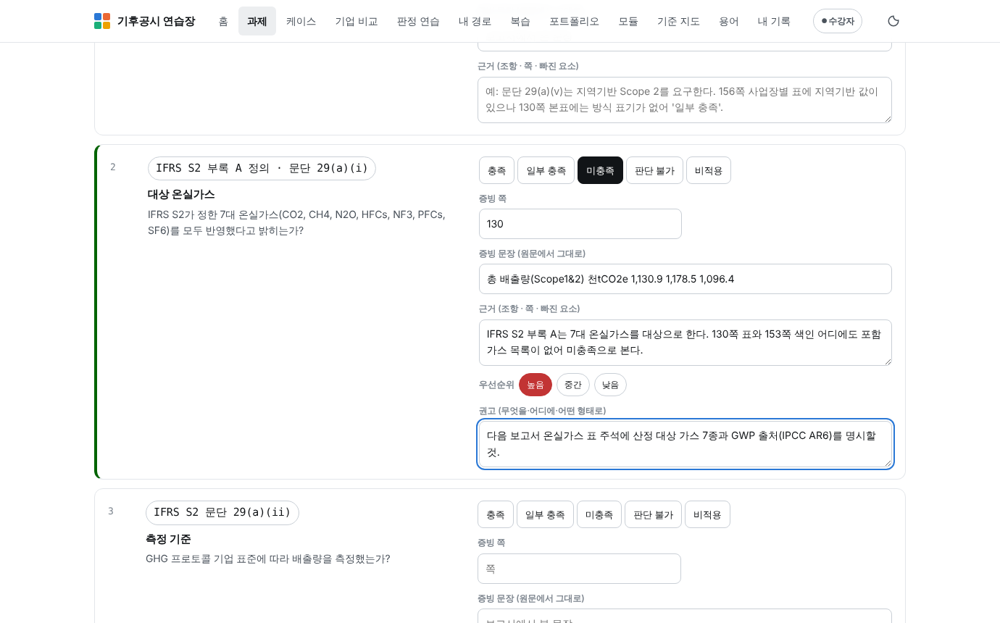
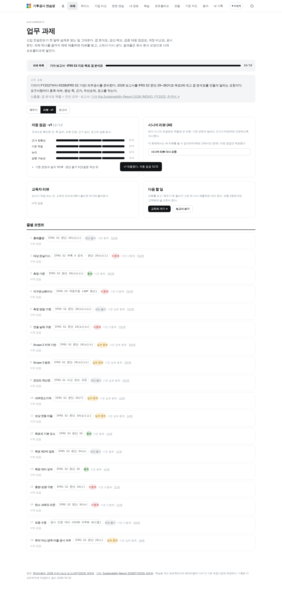
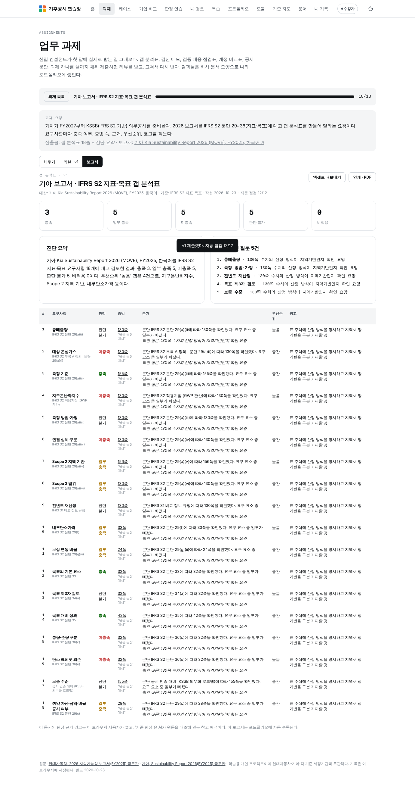
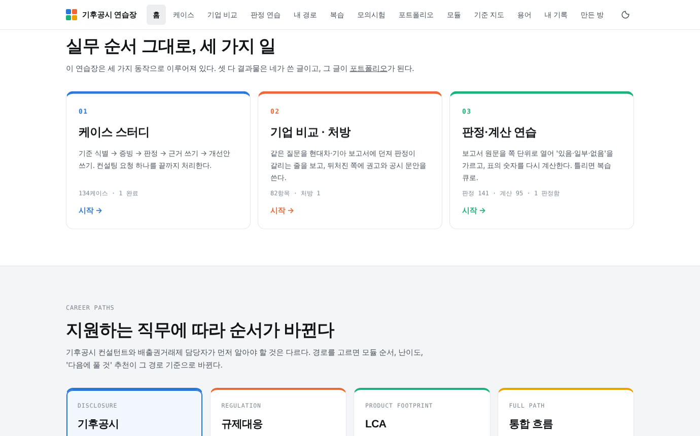
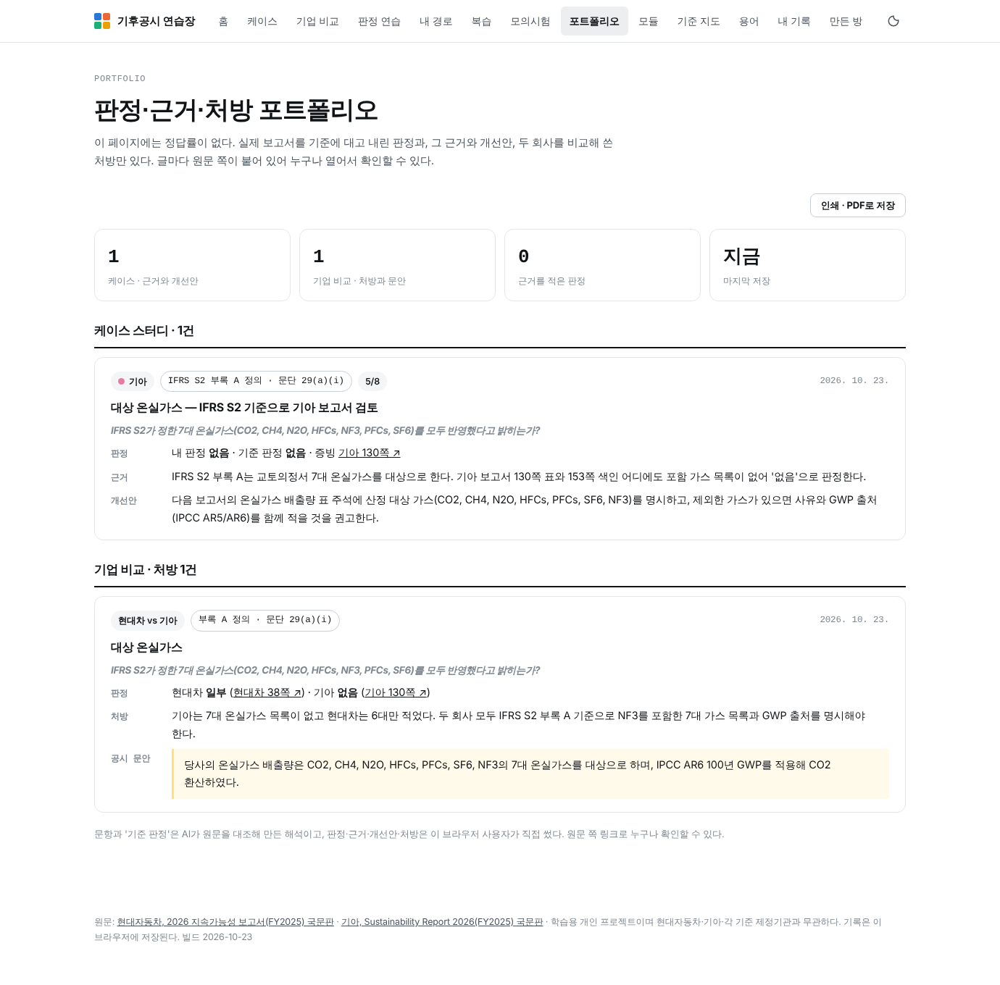
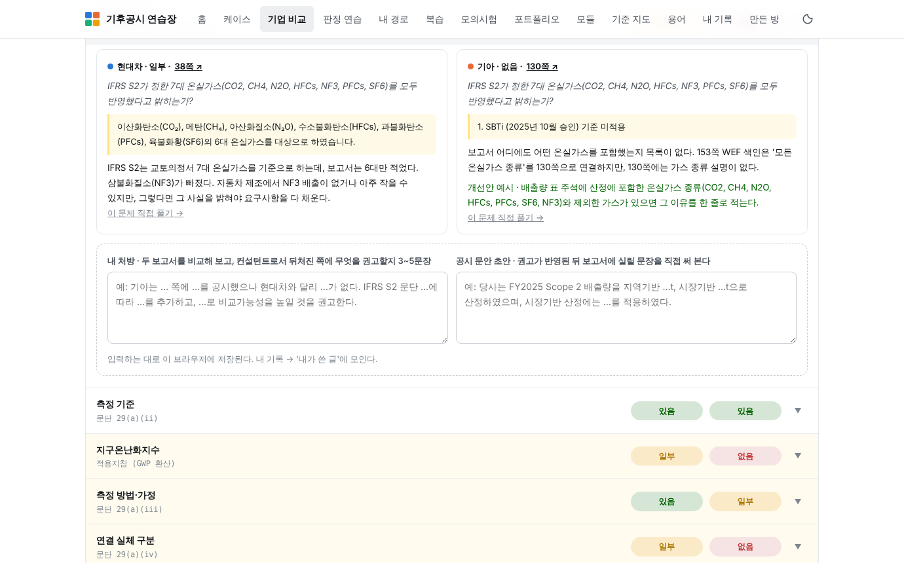

# Climate Change Professional Maker · 기후공시 연습장 (v4.0 · 전문 교육 플랫폼 방향)

기후공시 컨설턴트가 되기 위해 **어떤 기후공시 문제가 나와도 풀 수 있게** 만든 학습 웹앱입니다.
컨설턴트가 하는 일 그대로입니다. 실제 보고서 두 권(현대자동차·기아, FY2025)을 기준서에 대고 '있는지, 충분한지' 판정하고, 숫자를 다시 계산하고, 근거·개선안·처방을 글로 씁니다. **외우기용 문항(기준의 역사·설립 시기·정의 암기 등 122문항)은 뺐습니다** (`data/exclude.json`, 데이터 파일에는 남아 있음).

**라이브:** `index.html` 하나로 동작합니다. GitHub Pages를 켜면 바로 열립니다. 기록은 브라우저(localStorage)에만 저장되며, 내 기록 화면에서 JSON으로 내보내고 가져올 수 있습니다.



## v4.5 — 교재 중심 과정, 진단, 진로 3개

- **진로 3개**: 기후공시 컨설턴트 · 온실가스 컨설턴트 · LCA 컨설턴트. 각 과정은 **실제 업무 흐름 순서**의 장(예: LCA는 목표·범위 정의 → LCI → LCIA·해석 → 탄소발자국·EPD → 공급망·규제 → 보고서 연결)으로 다시 짰다.
- **교재** (`data/textbook/<track>.json`, 규격 `data/TEXTBOOK_SCHEMA.md`): 3권 22장 **117쪽**. 장마다 "실무에서는"(이 단계에서 신입이 받는 일) → 개념 → 그림·표 → 두 보고서의 실제 예(쪽 링크) → 읽은 것 점검 1~2문항. 점검을 풀어야 다음 쪽이 열린다. 공식 자료로 대조했고, 2차 자료만 연 곳은 본문에 "(2차 자료 기준)"으로 표시.
- **배경지식 진단** 10문항 → 8점 이상이면 '기초 다지기' 장을 건너뛴다.
- 게임 용어 제거(진로·과정·단계·진행 점수), 본문 17px·다크 대비 상향, 용어 검색은 제목 시작 → 제목 포함 → 설명 순, 다크/라이트 글자 토글.

## v4.3 — 전직과 노드 보드 (디아블로·GT7식)

- 첫 실행은 **클래스 선택**: 기후공시 컨설턴트 / 온실가스 컨설턴트 / LCA 컨설턴트 / 기후변화 컨설턴트(통합). 카드에 공고에서 보는 다른 이름(ESG 공시, 배출권거래제, 탄소발자국…)을 함께 적음.
- **코스 보드**: 챕터를 구역으로, 노드를 격자 위에 배치해 선으로 잇는다. 노드 모양으로 종류 구분(원=읽기·해 보기, 육각=과제, 마름모=케이스, 사각=비교, 별=수료). 끝낸 길과 켜진 노드는 클래스 색, 현재 노드는 맥박, 잠긴 노드는 자물쇠. 노드를 누르면 아래 카드(제목·분량·보상 XP·시작)가 뜬다.
- 기본 테마 다크, 포인트 컬러는 클래스 색 하나.

## v4.1 — 덜어내기

- 모의시험 제거(교육 목표와 무관, 점수 중심으로 되돌림). 복습 큐는 유지.
- 홈 재구성: 프리즘·중대성 스펙트럼·'반전 5가지'·난이도 카드 제거, 대신 **오늘 할 일**(다음 과제·리뷰 확인·케이스·복습·경로 추천) 카드. 규제 시계는 기준 지도로 이동.
- 판정 연습의 모듈 선택을 '과제에 쓰이는 모듈(판정·계산 중심)' 우선, 상황 판단형 객관식은 '보조'로 뒤에.
- 상단바: 홈·과제·케이스·비교 + 연습▾·나▾·참고▾ 드롭다운. 교육자 모드는 강의실·콘텐츠.

## v4.0 — 업무 과제와 리뷰 루프, 수강자/교육자 모드

컨셉을 **"전문 교육 플랫폼"**으로 잡았습니다. 지금은 수강자 모드가 완성 단계이고, 교육자 모드는 자리만 잡았습니다(DB 연결 후 구현).

- **업무 과제 8종** (`data/assignments.json`): 갭 분석표(기아·현대차 IFRS S2 지표·목표), 검산 메모(기아·현대차), 검증의견서 대응 점검표, KSSB 의무공시 준비 점검표, 개정 비교표, 공시 문안 초안. 신입 첫 달 주차별 순서.
- **3단계 비계**: 입문(힌트·쪽 링크 열림) → 실무(힌트 없음, 쪽·증빙 문장·근거 직접) → 제출(우선순위·권고까지).
- **5단계 판정**: 충족 / 일부 충족 / 미충족 / **판단 불가(→ 고객 확인 질문 필수)** / 비적용.
- **제출 → 리뷰 → 재제출**: 자동 점검(4축 루브릭: 근거 정확성·기준 적용·논리·실행 가능성, 12점) + 시니어 리뷰(AI, 아티팩트 안에서만) + 교육자 리뷰 칸. 제출마다 버전(v1, v2…)이 남고 점수 변화가 보입니다.
- **보고서 생성**: 갭 분석표 + 진단 요약 + 고객 확인 질문 목록, 엑셀 내보내기, 인쇄(PDF). 포트폴리오에 자동 수록.
- **수강자/교육자 모드 스위치**: 메뉴 오른쪽 버튼. 교육자 모드에는 강의실(준비 중)과 콘텐츠 관리(현황·추가 방법).
- 제출물 구조(수강자 · 과제 · 제출 버전 · 리뷰)는 그대로 PostgreSQL 테이블이 됩니다.

| 과제 목록 | 채우기(제출 단계) | 리뷰 | 보고서 |
|---|---|---|---|
|  |  |  |  |

## v3.1 — 실무 중심 재편

- 홈과 메뉴를 **케이스 스터디 → 기업 비교·처방 → 판정·계산 연습** 순서로 뒤집었습니다. 입문 글은 막힐 때 읽는 참고로 내려갔고, 공시 체계 지도는 문항 없는 참고 글이 됐습니다.
- **포트폴리오** 페이지: 정답률 없이, 작성자가 쓴 판정·근거·개선안·처방과 그 원문 쪽 링크만 모아 보여 줍니다. 인쇄(PDF) 가능.
- 남은 504문항: 판정 141 · 계산 95 · 상황 판단형 객관식 268.

## v3에서 달라진 것

| 기능 | 내용 |
|---|---|
| **내 경로** (취업 경로별 학습) | 기후공시 / 규제대응 / LCA / 통합 흐름 4경로. 경로를 고르면 5단계 스테퍼, 모듈 순서, 난이도, '지금 할 것' 추천이 바뀝니다. 추천은 정답률·남은 문항·약한 모듈로 매번 다시 계산합니다. |
| **기업 비교** | 현대차에 던진 71개 판정 질문을 기아 보고서에도 그대로 던졌습니다. 같은 질문 64개, 판정이 다른 29개. 줄을 펼치면 두 보고서 원문·해설이 나란히 나오고, **내 처방**과 **공시 문안 초안**을 직접 씁니다. |
| **케이스 스터디** | 기준 식별 → 증빙 쪽 찾기 → 판정 → 근거 쓰기 → 개선안 쓰기의 5단계. 앞 3단계는 자동 채점, 뒤 2단계는 쓴 뒤에 모범 답안이 열리고 스스로 점검합니다 (8점 만점). |
| **문항 신뢰도 꼬리표** | 문항마다 '원문 대조 / 재검산 / 공식 자료 / 공식 자료·주의 / 2차 자료 / 확인 필요'가 붙고, 만든 방법 페이지에 모듈별 집계표가 있습니다. 모듈마다 **기준 시점**(전제하는 기준서 버전)을 적었습니다. |
| **왜 틀렸나** | 틀린 뒤 이유(기준을 몰랐다 / 못 찾았다 / 판단 착오 / 계산 실수 / 잘못 읽음)를 고르면 내 기록에 쌓이고 처방이 나옵니다. |
| 기아 회사 팩 | 판정 70 · 계산 12 문항 (`data/companies/kia.json`). 모든 인용문은 원문 텍스트와 대조했고 계산은 Python으로 재검산했습니다. |

## 무엇이 들어 있나

| 영역 | 모듈 |
|---|---|
| 지도 | 공시 체계 지도 (참고 글, 문항 없음) |
| 공시 기준 | IFRS S1 · IFRS S2 지표·목표 · IFRS S2 거버넌스·전략·위험 · KSSB 제2호 · ESRS E1 기초 · ESRS·CSRD 심화 · GRI·SASB 기초 · GRI 심화 |
| 측정·검증 | GHG 프로토콜 · LCA·제품 탄소발자국 · 제3자 검증 · 물리적 위험·기후과학 · 시나리오 분석·재무영향 |
| 제도·시장 | 국내 기후 제도 · 탄소시장·CBAM · 감축목표·전환계획 · 금융배출량·택소노미 |
| 실무·평가 | ESG 평가 대응 · 보고서 작성 실무 |
| 기업 사례 | 기아 보고서 판정 (현대차 질문과 같은 key로 정렬) |

- **20개 연습 모듈 + 참고 글 1 · 504문항** — 판정(보고서 원문 대조) · 상황 판단(객관식) · 계산, 난이도 입문/실무/전문가
- 모듈마다 **입문 글**과 **핵심 용어** → 용어집
- **복습 큐**(1→3→7→14일), **내 기록**(영역별 정답률, 모듈×난이도 숙련도, 판정 경향, 왜 틀렸나, 내가 쓴 글)
- **기준 지도** — 공시 주제 8개를 IFRS S2·KSSB·ESRS·GRI·SASB·CDP 조항에 대응

| 세 가지 일 | 포트폴리오 | 기업 비교 |
|---|---|---|
|  |  |  |

## 만든 방법과 역할

이 프로젝트는 AI(Claude)와 함께 만들었습니다. 역할을 분명히 적습니다.

**김수현이 한 일**
- 채용공고(ESG 컨설턴트)의 업무 범위에 맞춘 기준 선정, 전 영역 확장과 취업 경로별 학습 설계 기획
- "판정이 의견일 뿐 아니냐", "규칙형·원칙형은 없는 말이다", "내가 안 하면 끝나지 않는 구조다", "보고서를 역으로 읽는 건 정답지 베끼기 아니냐" 같은 문제 제기로 평가 방식과 설계를 바꿈 → 케이스 스터디와 처방 쓰기
- 문제 풀이, 판단 근거·개선안·처방 작성(내 기록), 기준서 검색용 RAG 구현(진행 중)

**AI가 한 일**
- 영역 설계, 기준서·법령·감독기관 공개 문서 대조, 문항과 입문 글, 회사 팩 작성
- 계산 문항 전부 Python 재검산, 두 보고서 인용문 쪽 대조
- 문제를 만들지 않은 별도 AI 세션(6갈래)의 교차 검토 후 수정 반영. **사람 전문가의 검토는 아직 받지 않았습니다.**
- 웹앱 설계와 구현

## 신뢰도와 한계

- 정답은 공개 자료를 대조한 해석입니다. 판정 문항의 '일부'와 '없음' 경계는 전문가마다 다를 수 있습니다.
- 문항 신뢰도 집계(빌드 시 자동): `data/check.json`. 앱 안 '만든 방법' 페이지에 모듈별 표가 있습니다. 2차 자료만으로 확인한 문항과 '주의' 표시 문항은 숨기지 않고 그대로 셉니다.
- 2025~2026년에 개정이 많습니다(IFRS S2 GHG 개정, ESRS 간소화, GHG 프로토콜 개정 진행, SBTi V2, 배출권거래제 4차 계획기간). 모듈의 '기준 시점'과 문항의 기준 연도를 함께 읽어야 합니다. 한국 의무공시 일정은 금융위 최종안 기준이며 법제화가 끝나야 확정됩니다.
- KCGS 공식 자료, KSSB 기준서 원문, 일부 ISO 문서는 열지 못해 2차 자료로 썼습니다.
- 틀린 문항을 찾으면 Issue로 알려 주세요. 출처 링크가 각 해설 끝에 있습니다.

## 구조

```
index.html              완성본(단일 파일, 자동 생성):  node src/build.js
src/page.html           페이지 템플릿 (HTML + JS)
src/style.css · extra.css · v3.css   스타일
src/build.js            데이터 합치기 + 데이터 검사(중복 id, 보기, 계산 허용오차, 출처 URL) + 신뢰도 꼬리표 부여
data/modules/*.json     15개 모듈 (lesson + items) · lessons-v1.json (v1 모듈 입문 글) · data/SCHEMA.md
data/v1/*.json          v1 모듈(KSSB·ESRS·GRI·SASB·ESG 평가·기준 지도) · ifrs-s2-data.js
data/companies/         kia.json (회사 팩) · keys.json (질문 key ↔ 현대차 문항) · BRIEF.md (회사 팩 규격)
data/assignments.json   업무 과제 8종 (유형·회사·기준·행 문항 id)
data/tracks.json        진로 3개 (직함·별칭·직무)
data/courses.json       진로별 과정 — 장(업무 단계)과 단계(교재·해 보기·과제·케이스·비교)
data/textbook/*.json    교재 3권 (장·쪽·그림·예·점검) · TEXTBOOK_SCHEMA.md 규격
data/diagnostic.json    배경지식 진단 10문항
data/exclude.json       연습에서 뺀 외우기용 문항 id와 사유
data/check.json         빌드 검사 결과 (문항 수, 신뢰도 집계, 경고)
reports/                기아 보고서 원문 PDF (판정 문항의 '원문 열기'가 쪽 단위로 연결)
archive/v1, v2          이전 완성본
```

문항 추가는 `data/modules/<module>.json`에 규격대로 넣고 `node src/build.js`를 실행하면 됩니다. 회사 팩 추가는 `data/companies/BRIEF.md` 규격으로 `<company>.json`을 만들고 build.js의 COMPANIES에 등록합니다.

## 다음 계획

- 4.1 리뷰 고도화(교육자 리뷰 입력, 루브릭 조정) → 4.2 Supabase DB·계정·강의실 대시보드 → 4.3 콘텐츠 관리(문항 단위 기준 버전·검수 상태·개정 영향) → 4.4 과정 빌더(4주 신입 과정, 1일 특강) → RAG 연결·실습실·게시판.
- 외부 교육에 쓰려면 핵심 문항 세트의 실무자 검수가 필요합니다.

## 출처

현대자동차, 2026 지속가능성 보고서(FY2025) 국문판 · 기아, Sustainability Report 2026(FY2025) 국문판 · IFRS 재단(IFRS S1/S2, SASB) · 금융위원회·KSSB · EFRAG·EUR-Lex(ESRS, CSRD, CBAM) · GRI · GHG Protocol · SBTi · CDP · EcoVadis · S&P Global · 환경부·온실가스종합정보센터 · IPCC·IEA·NGFS · 기상청. 문항별 출처는 앱 안 해설과 '만든 방법' 페이지에 있습니다.

학습용 개인 프로젝트이며 현대자동차·기아 및 각 기준 제정기관과 무관합니다. 보고서 PDF는 원문 대조 학습 목적으로만 포함했습니다.
