# Scope 0 · 기준서부터 · Climate Change Professional Maker

> Scope 1·2·3을 세기 전에, 규칙(기준서)부터.

기후공시·온실가스 **기준서와 고시를 원문 PDF로 하나씩 읽는** 개인 읽기 공간입니다. 해설과 요약을 붙이지 않고 원문을 읽습니다. 읽다 막힌 점을 남기고, 원문에서 답과 근거 문단을 찾습니다. 진도와 기록은 공개합니다.

**사이트:** https://goalbangg-prog.github.io/Climate-Change-Professional-Maker/reading/

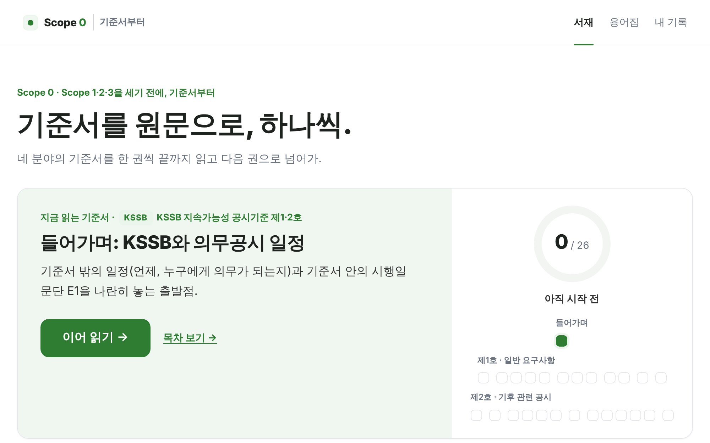

## 서재 (2026-10-27 기준)

기준서 하나가 확장팩 하나입니다. 원문 PDF와 쪽수를 검수한 확장팩만 **읽기 가능**으로 열고, 나머지는 **목차 준비** 상태로 서재에 꽂아 둡니다.

| 분야 | 확장팩 | 판본 | 상태 |
|---|---|---|---|
| 기후공시 | KSSB 지속가능성 공시기준 제1·2호 | 2026.2 의결본 | **읽기 가능** · 26항목 |
| 기후공시 | IFRS S1·S2 | ISSB 2026 edition (S2는 2025.12 개정 반영) | 목차 준비 · 23항목 |
| 온실가스관리 | GHG 프로토콜 기업 회계 및 보고 표준 | 2004 개정판 · 한국어 공식 번역 2025.6 (푸른아시아) | **읽기 가능** · 14항목 |
| 온실가스관리 | GHG 프로토콜 Scope 2 지침 | 2015 | 목차 준비 · 6항목 |
| 온실가스관리 | GHG 프로토콜 Scope 3 표준 + 산정 지침 | 2011 · 산정 지침 2013 | **읽기 가능** · 20항목 · 한국어 길잡이 163칸 |
| 온실가스관리 | KS I ISO 14040 전과정 평가(LCA) | KS I ISO 14040:2006 | **읽기 가능** · 10항목 · 원문 링크형(공식 뷰어에서 읽음) |
| 온실가스관리 | 배출권거래제 배출량 보고·인증 지침 · 검증지침 | 제2025-64호 · 제2025-165호 | 목차 준비 · 20항목 |
| 온실가스관리 | 온실가스 목표관리 운영 등에 관한 지침 | 제2025-165호 (2025.10.7 시행, 별표 포함) | **읽기 가능** · 9항목 |
| 온실가스관리 | 탄소중립기본법 · 배출권거래법 (법률·시행령) | 2026.11.12 · 2026.4.29 · 2026.10.8 시행 | 목차 준비 · 19항목 |
| 지속가능경영보고 · ESG 평가 | — | — | 원문이 정해지면 꽂음 (후보: GRI, SASB, CDP, EcoVadis 등) |

**합계:** 확장팩 9개, 그중 읽기 가능 5개(79항목). 용어집은 원문 정의 74개(KSSB 29, 목표관리 지침 45)입니다.

## 읽는 방식

하루에 목차 항목 하나를 읽습니다. 항목마다 **1 지도 → 2 원문 → 3 궁금한 점** 순서로 진행합니다.

- **목차:** 원문 목차의 장 제목을 뼈대로 묶고, 항목마다 실제로 읽는 쪽수를 표시합니다. KSSB 제1호 핵심요소 ↔ 제2호 거버넌스·전략·위험관리·지표 및 목표처럼 **이어지는 곳**을 서로 연결합니다.
- **지도:** 이 항목이 기준서의 어디에서 무엇을 정하는지 한두 문장으로 알려 주는 위치 안내입니다. 요약이 아닙니다.
- **원문:** pdf.js로 PDF를 폭에 맞춰 그대로 그리고, 그날 읽을 쪽만 보여 줍니다. 적용지침·별표·참고 문서(예: Scope 3 산정 지침의 범주별 장)는 옆에서 바로 열 수 있습니다.
- **한국어 길잡이 (영어 원문만):** 절마다 핵심 용어(영↔한), 무엇을 정하는지, 요구(shall)·권고(should)·선택(may)을 짚습니다. 번역문이 아니며, 화면에 "AI 초안"과 원문 대조 여부를 표시합니다.
- **궁금한 점:** 막힌 문장을 한 줄로 남기고, 원문에서 답을 찾으면 답과 근거 문단을 답니다. 기록은 브라우저에 저장하고, 공개용 파일(`reading/log/public.json`)로 내보내 진도를 공개합니다.
- **용어집:** 기준서의 '용어의 정의'만 원문 문장 그대로 싣고, 정의가 실린 쪽을 바로 엽니다.

| 목차 | 지도·원문 |
|---|---|
| 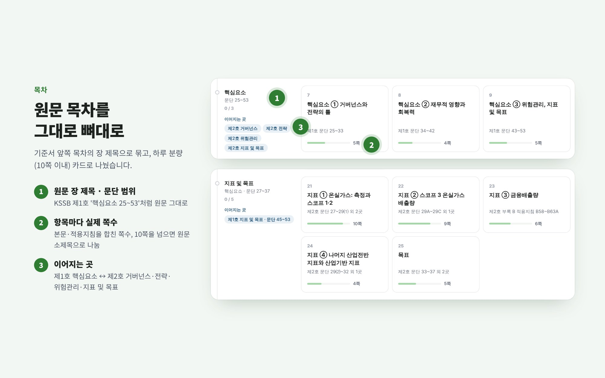 | 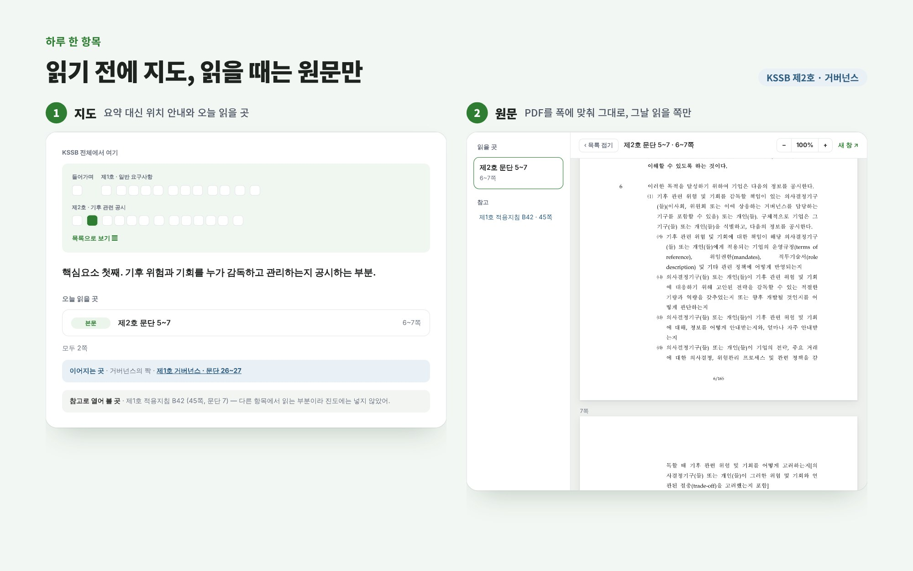 |
| **궁금한 점·용어집** | **영어 원문과 한국어 길잡이 (Scope 3)** |
| 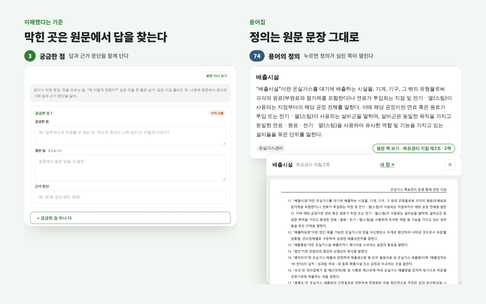 | 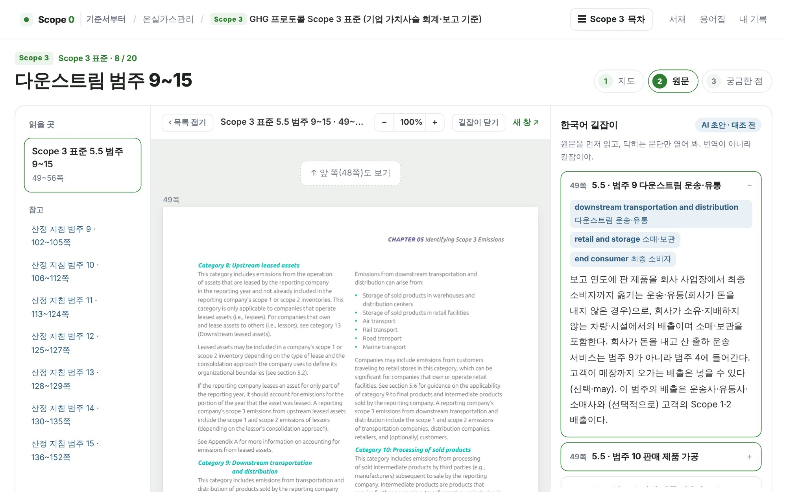 |

## 검수 원칙

- **쪽 번호는 PDF 쪽 순서**입니다. 인쇄 쪽 번호와 다른 문서는 차이를 확인해 적었습니다(Scope 3 표준 +2, 기업 표준 번역본 +8).
- **원문 목차대로** 나눕니다. 한 항목이 10쪽을 넘으면 원문의 절·소제목을 기준으로 나눕니다.
- **적용지침·별표는 가리키는 조문에 붙입니다.** KSSB 적용지침 132문단은 빠짐·중복 없이 한 번씩 배정했는지 코드로 확인했습니다.
- **용어집은 원문 그대로** 옮기고, 넣은 뒤 PDF 글자와 공백을 빼고 비교해 100% 일치를 확인합니다.
- **사실만 씁니다.** 쪽수·문단·숫자는 PDF에서 확인한 것만 씁니다. AI가 쓴 글(길잡이)은 화면에 "AI 초안"으로 표시합니다.
- 원문 PDF에는 출처와 공식 링크를 함께 표시합니다. 저작권자가 요청하면 내리고 공식 링크로 바꿉니다.
- 다운로드를 막아 둔 저작물 표준(ISO·KS 등)은 **원문 링크형**으로 꽂습니다. 원문·캡처·정의 문장은 저장소에 넣지 않고, 조항 목차와 위치 안내만 두며 원문은 공식 뷰어에서 읽습니다.

## 구조

```
reading/
  index.html, app.js, style.css    사이트 (서버 없음, 해시 주소)
  packs.json                       분야 4개 + 꽂힌 확장팩 목록
  packs/<id>/pack.json             확장팩 하나 = 기준서 하나 (원문 장 뼈대 · 항목 · 쪽 범위 · 지도 · 길잡이)
  packs/<id>/pdf/*.pdf             원문 PDF
  glossary.json                    용어집 (원문 정의만)
  log/public.json                  공개 기록
docs/DEFINITION-v5.md              정의서 (유일한 기준)
docs/HANDOFF.md                    인수인계 · 데이터 형식 · 확장팩 검수 방법
```

## 다음 계획

1. 배출권거래제 확장팩 검수. 보고·인증 지침(제2025-64호)은 별표 1~22가 든 파일을 받은 뒤 진행합니다.
2. IFRS S1·S2 검수와 한국어 길잡이
3. GHG 프로토콜 Scope 2 지침 검수와 길잡이
4. 법령 확장팩 검수 (별표가 든 법령 파일을 받은 뒤)
5. Scope 3 길잡이 원문 대조, 기업 표준 번역본 용어해설의 용어집 반영
6. 읽은 기록을 일주일에 한 번 공개 기록으로 올리기

## 만든 방법과 역할

이 프로젝트는 AI(Claude)와 함께 만들었습니다.

- **김수현:** 정의서를 쓰고 무엇을 만들지 정합니다. 원문 PDF를 확보하고, 목차 구성·화면을 결정하며, 실제로 읽으면서 고칠 점을 냅니다.
- **AI:** 정의서에 따라 원문 쪽 매핑, 항목 나누기, 용어집 대조, 길잡이 초안, 웹 구현을 합니다.

학습용 개인 프로젝트이며 KSSB·ISSB·WRI/WBCSD·기후에너지환경부 등 각 기관과 무관합니다.

---

## 이전 버전: 기후공시 리딩 클래스 (v5)

저장소 첫 화면(`index.html`)은 이전 버전입니다. 기준서 원문을 문단 순서대로 함께 읽는 교육 사이트로, 해설과 기업 보고서 예시를 붙였습니다. 이 경험에서 "요약은 맥락이 끊긴다"는 점을 배워 지금의 Scope 0(원문만 읽기)으로 바꿨습니다.

**이전 버전:** https://goalbangg-prog.github.io/Climate-Change-Professional-Maker/

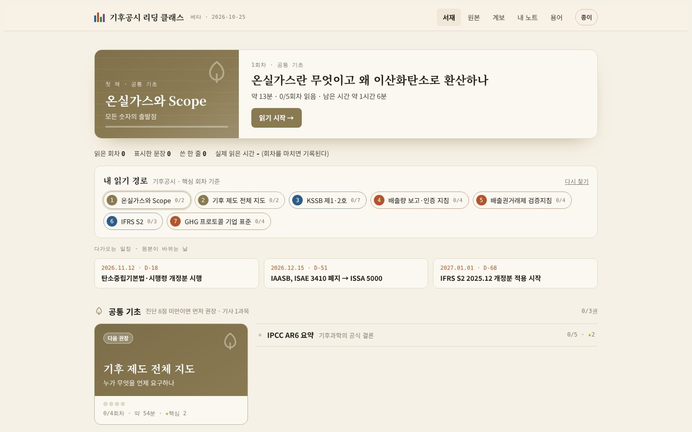

### 무엇이 들어 있나

- **원본 20종**을 원문 그대로 대조했습니다. 판본과 시행일은 원문 머리글에서 옮겼습니다.
- **책 13권, 118회차**가 있습니다. 회차는 15~20분 분량이고, 기준서 목차 순서대로 1~3문단씩 읽습니다.
- **용어집 438개**를 담았습니다.
- 책마다 **독립 검수**를 받았습니다. 고친 곳 69곳과 확인 필요로 남긴 것을 사이트 안에 그대로 공개합니다.

| 분류 | 원본 (판본) |
|---|---|
| 공시 | KSSB 제1호·제2호 (2026.2 의결본) · IFRS S1 (ISSB 2026 edition) · IFRS S2 (2023.6 원문 + 2025.12 개정) |
| 산정 | GHG 프로토콜 기업 표준 (2004 개정판) · Scope 2 지침 (2015) · Scope 3 표준 (2011) · Scope 3 산정 지침 (2013) · 배출량 보고·인증 지침 (제2025-64호, 구판 제2021-278호 대조) |
| 검증 | 배출권거래제 검증지침 (제2025-165호, 별표 포함) |
| 법령·제도 | 탄소중립기본법·시행령 (2026.11.12 시행분) · 배출권거래법 (2026.4.29 시행)·시행령 (2026.10.8 시행) · 목표관리 운영 지침 · 환경정보공개제도 운영규정 · K-택소노미 가이드라인 (2025.12) |
| 과학·통계 | IPCC AR6 종합보고서 (2023, 영문 + 기상청 국문) · IPCC AR6 WG1 정책결정자 요약 (2021) · 국가 온실가스 인벤토리 보고서 2024 (국문 + 영문 NID) |

원문 텍스트는 `data/sources/`에 있습니다. KSSB 원문 PDF는 저장소 밖에서 대조했습니다.

### 화면

| 화면 | 하는 일 |
|---|---|
| **서재** | 이어 읽기, 내 읽기 경로, 다가오는 개정 일정(D-day), 영역별 책장. 준비 중인 책은 한 줄로 접어 둡니다. |
| **읽기** | 원문 문장 → 쉬운 풀이 → 이 문단이 요구하는 것 → 기아·현대차 보고서의 실제 예. 문장마다 밑줄·형광펜·메모를 남기고, 끝에서 한 줄 쓰기(키워드 채점)와 헷갈림 점검을 합니다. |
| **회차 길잡이** | 데스크톱에서는 오른쪽에 문단 목록이 나오고, 지금 읽는 문단과 지나온 문단을 표시합니다. 폰에서는 "문단 2/6 · 약 9분 남음"을 보여 줍니다. 실제로 읽은 시간도 회차별로 기록합니다. |
| **★ 핵심 회차** | 책마다 실무 뼈대가 되는 회차를 고르고 이유를 달았습니다. 예: KSSB는 23회차 중 7회차. "핵심만 읽기"로 그 회차만 따라갈 수 있습니다. |
| **원본 도감** | 원본 20종 카드(분류·관할·상태·판본·일정·확인일·쓴 책). 분류·관할·상태로 거를 수 있습니다. |
| **개정 이력** | 원본이 바뀌는 날을 앞에(D-day), 지난 일은 연도별로 보여 줍니다. 이 사이트 본문에 반영됐는지(반영됨·반영 대기)와 근거 회차를 함께 답니다. |
| **정정 기록** | 책별 검수일, 고친 곳, 확인 필요 건수, 검수 단계. 빌드할 때 `data/books/REVIEW-*.md`에서 자동으로 셉니다. |
| **문단 계보** | 한 요구사항이 문서 사이를 어떻게 흐르는지 문단 번호로 잇습니다. 첫 줄기는 "Scope 1·2 배출량"입니다(GHG 프로토콜 → 보고·인증 지침 → 검증지침 → IFRS S2 → KSSB, 6갈래·노드 23개). 관계는 바탕·참조·차이 세 가지이고, 모든 선에 근거 회차가 달려 있습니다. KSSB↔IFRS S2 대응표도 여기 있습니다. |
| **내 읽기 경로** | 하려는 일(공시·온실가스·LCA), 배출권거래제·목표관리제 대상 여부, 상장 대기업 여부, EU 수출 여부 4문항과 기초 진단 결과로 읽을 책 순서와 핵심 회차를 정해 줍니다. |

| 읽기 | 문단 계보 |
|---|---|
| 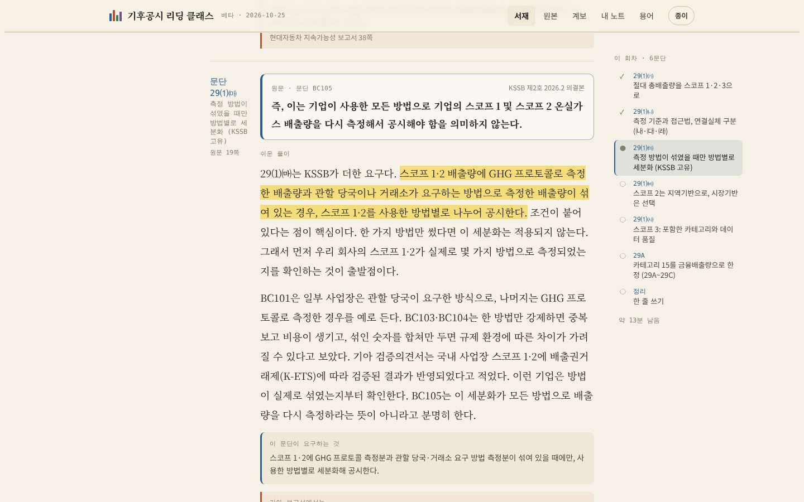 | 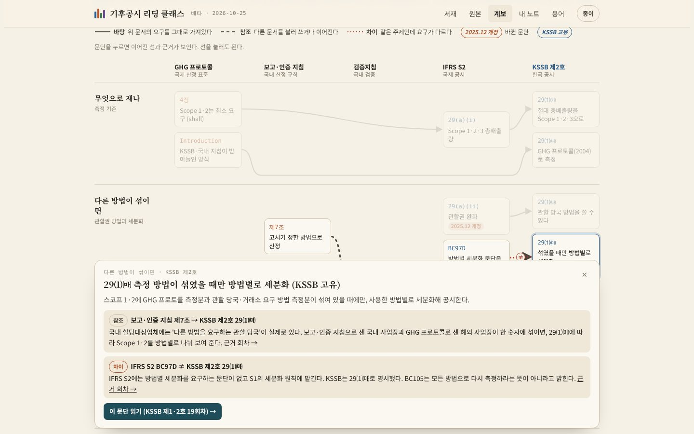 |
| **원본 도감** | **개정 이력** |
| 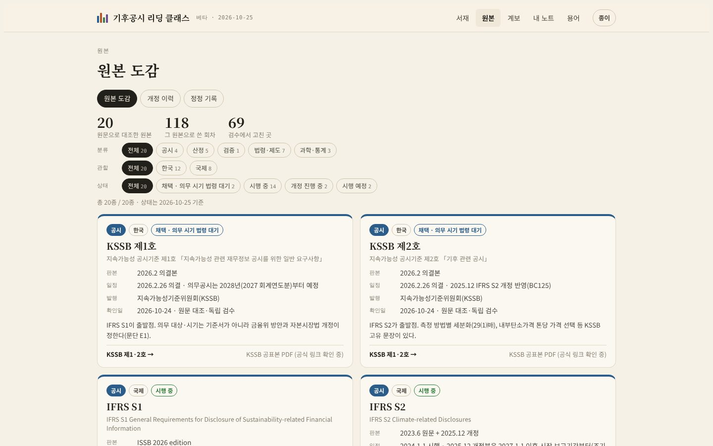 | 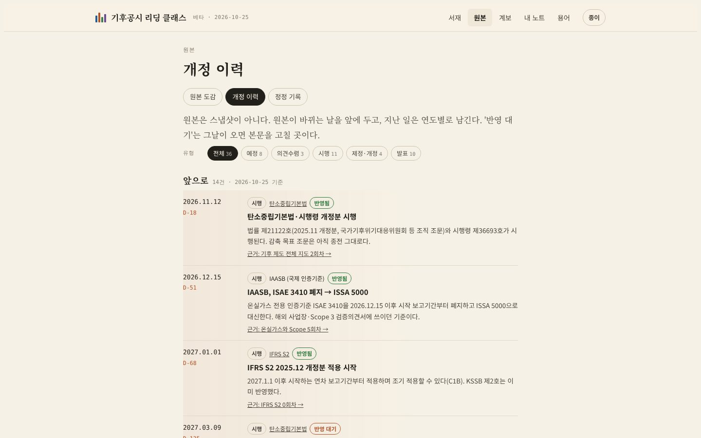 |
| **정정 기록** | **내 읽기 경로** |
| 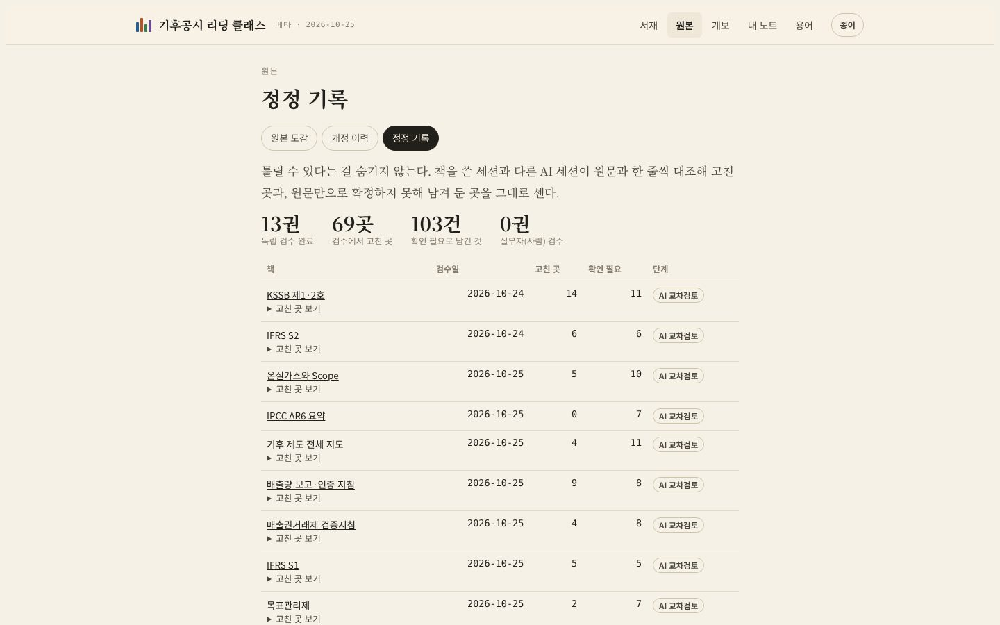 | 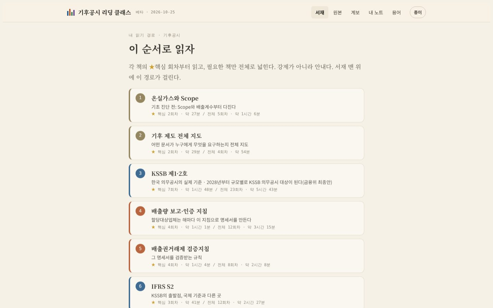 |

### 신뢰도 원칙

- 모든 설명은 기준서 문단 번호나 공식 자료에 묶습니다. 원문으로 확인하지 못한 것은 쓰지 않거나 "확인 필요"로 남깁니다.
- 원문 인용은 회차마다 짧게(블록당 두 문장 이하) 하고, 나머지는 문단 번호와 쪽수로 원문을 가리킵니다.
- 예시는 기아·현대자동차 보고서(FY2025)에 실제로 있는 문장과 숫자만 쓰고, 쪽수를 답니다.
- 검수 단계는 **AI 초안 → AI 교차검토 → 실무자 검수** 순서입니다. 지금 13권은 모두 두 번째 단계에 있습니다. 외부 교육에는 실무자 검수를 마친 회차만 쓸 계획입니다.
- 원본의 상태와 일정은 2026-10-25 기준입니다. 개정 이력의 "반영 대기" 항목은 그날이 오면 본문을 고칩니다.

### 만든 방법과 역할

이 프로젝트는 AI(Claude)와 함께 만들었습니다.

**김수현이 한 일**
- 채용공고의 업무 범위에 맞춰 기준을 고르고, 문제 풀이 앱(v4.5)에서 "기준서 함께 읽기"(v5)로 방향을 바꾸는 정의서를 썼습니다(`docs/DEFINITION.md`).
- KSSB 원문을 확보했고, 원고 수준을 피드백했습니다. "원본 기준서를 넣었다"는 점을 이 프로젝트의 핵심으로 정했습니다.
- 회차를 읽고 쓰기·검수 피드백을 합니다(진행 중).

**AI가 한 일**
- 원문 대조 원고 작성, 책마다 별도 세션으로 독립 검수, 데이터 설계(원본·개정·계보·핵심 회차), 웹 구현.

### 구조

```
index.html                 완성본(자동 생성)
src/reading.html           리딩 클래스 템플릿 (HTML·CSS·JS)
src/build-reading.js       책·원본·개정·계보·핵심 회차·정정 기록을 합쳐 index.html 생성, 참조 검사
src/build.js               예전 문제 풀이 앱(legacy.html)과 문항 data/items.gen.json 생성
data/books/*.json          책 원고 (회차 → 블록: 문단 번호·원문 쪽·원문 인용·풀이·요구사항·보고서 예·용어)
data/books/REVIEW-*.md     책별 독립 검수 보고서
data/sources/*.txt         원본 원문 텍스트
data/sources.json          원본 도감 (분류·관할·상태·판본·일정·확인일·쓴 책)
data/changes.json          개정 이력 (날짜·유형·반영 상태·근거 회차)
data/lineage.json          문단 계보 (노드 = 회차의 블록, 선 = 바탕·참조·차이 + 근거 회차)
data/core.json             책별 핵심 회차와 고른 이유
docs/DEFINITION.md         리빌딩 정의서
docs/HISTORY.md            v3~v4.5 기록
legacy.html                예전 문제 풀이 버전(v4.5)
```

빌드: `node src/build.js` → `node src/build-reading.js`. 계보·개정 이력·핵심 회차에서 없는 회차나 블록을 가리키면 빌드가 멈춥니다.

### 다음 계획

- KSSB 23회차를 직접 끝까지 읽고, 실제 읽은 시간과 한 줄 쓰기 통과율을 기록합니다.
- 실무자 1명에게 KSSB 일부 회차와 한 줄 쓰기 키워드 검수를 받습니다.
- 문단 계보를 넓힙니다(Scope 3, 목표, 내부탄소가격 줄기).
- 다음 책: ESRS E1, ISO 14064, ISO 14040·44, 탄소중립기본법·배출권거래법.

## 출처

각 원본의 판본과 공식 링크는 사이트의 원본 도감에 있습니다. 보고서 예시는 현대자동차 2026 지속가능성 보고서(FY2025)와 기아 Sustainability Report 2026(FY2025)에서 가져왔습니다.

학습용 개인 프로젝트이며 KSSB·ISSB·WRI/WBCSD·기후에너지환경부·현대자동차·기아 등 각 기관과 무관합니다.
